# 12.0 法师攻略（初版）

> **作者**：山神宫 · 狁辰
> **来源**：《无限升级》（TapTap app 241449）社区攻略 PDF《12.0法师攻略初版（山神宫—狁辰）》，本文为原文档的完整整理版。
> **整理说明**：文字按原文目录重新排版，图片按原位置就近插入，文件名中的数字对应原 PDF 页码（如 `p-005-000` = 第 5 页第 1 张图）。

---

## 前言

本攻略主要为法师玩家设计，战士玩家可以参考大部分内容，攻略涵盖从开局到最新 12.0 的大部分内容，如需进一步了解，请结合群文件其他攻略或咨询 QQ 群成员，本攻略旨在提供思路和参考，结合多位大佬的数据外加个人理解创作。

四个觉醒职业（先次元二再两万级觉醒）区别是主属性不一样（智法智力/神法神圣，套装名字和加的主属性不一样）以及技能的形态不一样，其他所有玩法都一样。因此觉醒职业不需要额外攻略。四个觉醒都能玩，纯看个人喜欢。

前期装备词条选择和轮回加点最重要。

12.0 版本很多重要内容都需要打英雄副本虚空蚀界逐步解锁。新增独立乘区属性虚空之力，目前用处不大，全渠道加起来触发几率仅 23%，除了两个新的秘法核心外，其他增加虚空之力的地方都有更好的属性选择。

---

## 目录

**基础讲解**

1. 挂图（感知和进次元二）
2. 装备（装备词条优先，套装可以转移。传说遗物袋和远古遗物袋有就开，最终毕业套在魔法兑换里可以预览。）
   - 装备等级 / 装备强化 / 装备词条 / 附魔·附灵 / 神作 / 套装 / 升星·封印 / 宝石
3. 技能
4. **（必看）** 升级 / 转生 / 龙塔 / 精血
   - 转生 / 转生神力加点 / 龙塔 / 精血加点
5. 广告
6. 抽奖（异界碎片的使用）
7. 兑换（神圣精华的使用）
8. 成就
9. 御灵（6 星御灵需要打英雄副本，萌新别想，先培养好五星）
10. 秘法
11. 御器
12. 魔物
    - 魔物装备 / 天界进化
13. 魔物封印
14. 锻造台
15. 圣遗物及圣法点
16. 奥术

**进阶内容**

1. 觉醒（前面技能有提过）
2. 远古秘境（更强套装兑换材料的获取渠道之一）
3. 英雄挑战（含材料用途介绍）
4. 虚空蚀界
5. 守护者（虚空蚀界打过第二关获得庇护法典背包物品使用后解锁）
6. 匠魂
7. **（必看）** 次元 3 到混沌次元再到次元 4
8. 停滞次元、灾厄次元和遗忘次元
9. 恶魔塔、量子观测者、黑塔宫殿
10. 天赋书
11. 光环（12.0 解锁上限至 21）
12. 创世装备
13. 主要 boss 强度比对表（山神宫－沉鱼收集制作，12.0 待更新）

**其他**

1. 爱发电/免广
2. 更换觉醒/职业
3. 更换设备/丢档
4. 兑换码

---

# 基础讲解

## 1. 挂图（感知和进次元二）

次元一 1000 关后开启感知功能，感知过程中会锁状态，因此不存在先输出再切换经验获取的投机操作，感知满后当前层经验最大值（根据面板经验加成），且不会改变（死亡、打副本都不变，只有切图会变），轮回后清除感知记录。离线经验是根据面板经验的，离线前一定要感知满。挂图一定要感知，因此请勿选择会导致平凡死亡的层数挂机，感知过程中死亡掉进度的。

角色闪避率达到 70%（上限）后，在挑战关卡时将激活异界护盾，获得 12 点能量，每点能量可抵御一次伤害。能量消耗完感知失败扣除感知进度，当感知失败并且进度低于 0% 不超过 5 次时将持续感知状态。到达第六次时才退出感知状态。护盾机制专门应用于挂图感知，能够有效提升挂图的稳定性，并无负面效应。

（题外话：龙塔 5000 层后每次转生先加 700 神圣满闪避再全智力，觉醒后精血加主属性），挂图就 999 或 9999 结尾挂，整数层有小精英，且每过一个整数怪物都会加强。升层就 500 或 1000 或 1 万这么整数升。例如：10 层强度 10，19 层强度 10.9，而 20 层强度 15。大概这个意思。

这游戏升次元最重要，初始就在次元一，一万级立刻转生点轮回面板最下面那个升次元，右侧秘境次元世界切换进次元二。10 万级转生够 1t 可进次元三。次元可以随意切换，次元一前 100w 关才有异界碎片奖励，未来强了可以随时回来。等级在 8000 级左右，升级效率不低面板经验一分钟三四级的情况下，就可以考虑憋到 1w 级，达到 1w 级后立刻轮回获得 1b 神力，可以在转生里往下拉解锁次元 2。优先进入次元 2，在次元 2 解锁后，可将多余的神力用于提升经验等其他方面。

## 2. 装备（装备词条优先，套装可以转移。传说遗物袋和远古遗物袋有就开，最终毕业套在魔法兑换里可以预览。）

拥有经验加成、法术加成和攻击力三词条的装备可视为小毕业，第四条词条可选生命值。前期可以穿戴经验加成和法术暴击，配合轮回，优先面板 100% 暴击，再慢慢换好词条装备。过渡阶段经验配法术加成或攻击力两词条可以用。腕甲部位特殊，暴怒加经验就比正常三词条好，其他条件不变。无需刻意追求四词条或五词条（含白词条），各部位白词条均有输出，生命值也很好。白词条与蓝词条装备属性固定，无法更改，仅能通过重锻调整数值。

### 装备等级

装备分为等级和［灵等级］，等级是当前等级，转生后归零。掉落装备后会获得你当前人物等级的装备等级（这个不重要）。灵等级默认为 1 级，升级灵等级转生后不会归零。升级灵等级需消耗金币及装备碎片，灵等级提升将增加装备等级上限，但装备等级与人物等级保持一致。金币无需刻意节省，前期推荐仅升级武器，提升攻击力就能直接增加输出能力。

### 装备强化

装备强化材料靠分解装备获得，比较缺少，前期只推荐强化武器，过渡武器最多强化到 +12，毕业三词条直接拉满 +20。其他 7 件装备强化都是加防御力，对挂图完全没有帮助，打 boss 有帮助，但是微乎其微。

### 装备词条

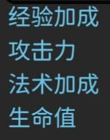

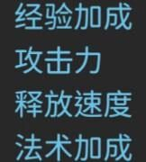

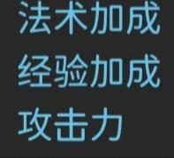

*图为装备蓝词条毕业 / 图为武器词条毕业（原文档配图）*

### 附魔/附灵

开局的装备可点两下附魔，不用洗附魔和清除附魔。没有三词条前不建议洗附魔，附魔优先经验次选法术加成和攻击力，可重复。附灵在暴击没满前可选暴击，暴击满了只选经验。锻造台快速附魔谨慎使用，材料消耗巨大，建议四词条毕业装再使用先在装备上洗好第一条附魔，再使用快速附魔。强能附魔功能也是洗练装备第二条附魔的，属性二选一也可以保留原来选项，充能进度 100% 后可以自选满属性附魔词条。

### 神作

装备供养选项需要一定等级才能看到，具体不详，前期可选两词条的装备来供养神作，洗出有用神作就停。三词条必洗法术投射物 +1，材料不够的话可先用有用神作，等攒够材料再洗。

神作属性选择：投射物 〉 法术加成 〉 其他

### 套装（套装可以通过锻造台转给好词条装备，其他任何套装都没必要穿）

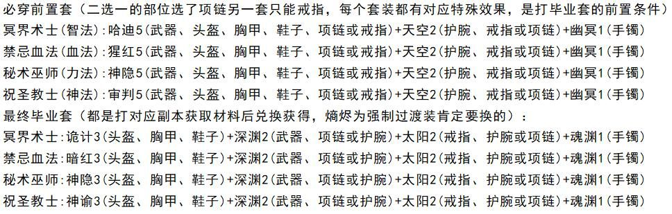

未觉醒状态下，建议仅直接佩戴幽冥手镯，不用任何其他套装过渡；觉醒后，则根据所觉醒的职业选择相应的觉醒套装。只有集齐前置套装，才有资格挑战对应副本获取材料，进而打造毕业套装。职业五件套获得觉醒控制可以打炼狱之门获得碎片兑换熵烬套，天空获得神域感召可以打神域守卫材料用于挑战卡拉萨斯，幽冥获得沉睡唤醒可以打沉睡巨蜥材料用于进阶魂渊套，熵烬获得炼狱抵抗可以打地心遗迹兑换地心套，地心职业三件套获得深渊吸收可以打异界网道材料用于进阶地心套。有资格不代表能立刻打过副本。

小知识：套装分解会给传说碎片，远古三级及以上套装分解额外给远古碎片，远古碎片可以在兑换里兑换随机或自选职业套装盒子，分解天空套获得黄金遗迹碎片兑换自选天空套盒子。护腕部位套装跟其他套装出处一样，橙装护腕只能通过金字塔和上古匠师秘境给的护腕腕甲专属袋子出（不理解但设定就是这样）。

### 升星/封印

升星：只建议升至少三词条装备，主升词条毕业武器

封印建议：仅推荐封印品质为橙色的魔物，其他品质的魔物无封印价值；已封印的魔物仅需提升自身等阶与封印等级即可。封印具体要什么请往下看魔物攻略。

分解强化的装备不返还消耗的传说碎片

升星还原规则：升星后的装备仅能还原至 1 星，且强化进度将归零（此状态方可放入锻造台进行下一步操作）。

### 宝石

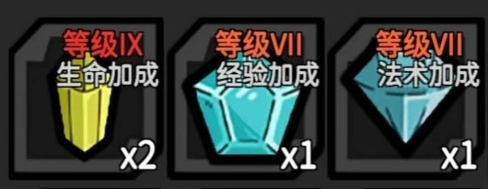

宝石只带法术加成和经验加成，比例法加 9：经验 15（两词条装备就可以开孔了，宝石提升很大，不要在开孔上省凿子），背包留生命加成宝石（很重要，未来打 boss 必要），其他宝石可以全分解。宝石只留有用的，无用的一律分解。宝石可以随意降级来获得三个低一级的宝石，宝石可拆卸。

推荐宝石搭配（比例都是慢慢过渡的，别一下子从 6 减到 3，面板法术加成可以维持在 2000% 以上再考虑完全不带法加宝石。）：

- 次元一和次元二：9 法术加成宝石 / 15 经验加成宝石
- 次元三：6 法术加成宝石 / 18 经验加成宝石
- 混沌次元（3.5）/ 次元四：3 法术加成宝石 / 21 经验加成宝石
- 停滞次元、灾厄次元、遗忘次元：1 到 3 法术加成宝石 / 24 经验加成宝石（创世装备镶嵌的槽位都放经验）

关于攻击宝石建议分解，但随你。9 级攻击宝石勉强相当于 6 级法术宝石，用处真不大。

宝石分解后可获得魔力粉尘，可在兑换里兑换宝石箱子。

## 3. 技能

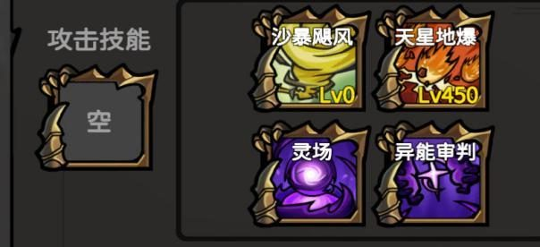

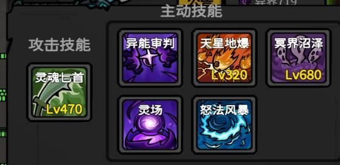

未觉醒前法师没有攻击技能，主动技能未觉醒前只有 4 个技能框。开局先带天雷术 / 火球雨过渡，但不建议强化。完成主线可获得天星地爆碎片，4 个主动技能框解锁后，装备沙暴飓风 / 天星地爆 / 异能审判 / 灵场。

觉醒后请按照图示佩戴觉醒 1 / 觉醒 2 / 天星地爆 / 异能审判 / 灵场 / 怒法风暴（1+5，留意技能描述，智法主动技能冥界沼泽是觉醒二技能，神法攻击技能净化冲击是觉醒二技能）。

技能碎片的处理方式：解锁完沙爆和地爆后，一星技能碎片全分解，二星技能只留怒法风暴和异能审判，二星技能强化满级后，多出的碎片分解。三星技能留沙爆 / 地爆 / 灵场。

技能粉尘可在魔法兑换里兑换觉醒技能（碎片）和技能宝箱，觉醒后优先兑换觉醒技能（碎片）优先升满觉醒二技能（技能介绍有说）。

未觉醒前技能升级：解锁完地爆和沙暴后主升地爆次升沙暴，升级比例：1.5:1 地爆 150 级、沙暴 100，哪个技能多升少升几级都行，大概比例就行。

觉醒后四个觉醒职业前期基本可以按照觉醒 2 / 觉醒 1 / 地爆，2:1:1 的升级比例。打塔将地爆换成沙暴。技能升级可提升伤害值，而强化则可增加主动技能投射物或增强被动技能属性。

还原等级反还灵魂，还原强化反还技能碎片。

## 4. （必看）升级/转生/龙塔/精血

### 转生

轮回只有 1 小时冷却限制，没有等级限制。每个人的情况不同，不需要按固定等级进行转生。在转生前，建议先升级装备，挑战龙塔，待这些准备工作完成后，再进行转生。不必因转生会清除技能等级与装备等级而觉得吃亏，转生是提升战力的最优途径。

具体几级转生并不重要，只要舍得转生就行。第一次轮回建议在 200-300 级左右，第二次建议在 600-1000 级（没氪金就早点 400 多也行），第三次 1500-3000。往后请自行选择轮回，最迟请按左下角面板经验收益 ÷ 升级所需经验（只按面板本身数据算）判断。次元一 5000 级前面板经验三五分钟升一级转，5000 级后慢慢变成一分钟升不了一级必转，到了次元二一般一分钟两三级就可以考虑转了，次元三慢慢到一分钟四五级也行，到了次元四就没有看面板经验转生的说法了，看你情况。

一定要保证双倍药水，再不济也要保持经验别断，不要在线挂机，离线经验三倍。

### 转生神力加点

等级的三次方就是神力，等级除 1000 的三次方，单位 m，或者等级除 1w 后的三次方，单位 b。也就是 1w 级是 1b 的神力，10w 级是 1000b=1t。

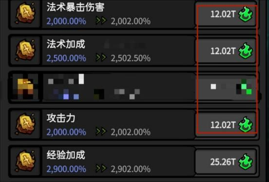

转生面板都是乘算，法师转生优先达成冷却 100%，觉醒 100%，法术暴击率看装备情况（前期起码也要 100% 以上），毕业一般在 400%，前期配合装备暴击率词条优先（很重要）面板满 100%，后面换装备前再补。神力加点需灵活变通，切勿盲目单点某一项，确保加点方案合理不浪费点数，上面说的冷却 / 觉醒 / 暴击率都是很重要且有准确上限的，够了就别点了，下面说的这些只要游戏还在玩就一直要点，点上面这些时可以配着先点点经验。

经验，攻击力，法术爆伤，法术加成，这四个是法师必要神力，也是往后长期要加的四个神力。剩余点数可分配给生命。

爆伤 / 攻击 / 法加成消耗持平加点（例如：经验 150%，爆伤 100% = 攻击 100% = 法术/物理加成 125%，轮回法术加成有 1.25 倍加成），在保持经验加点较高的同时，爆伤、攻击和法术加成的加点应保持均衡，经验高 50%。爆伤过 500% 后，经验高 100%（例如：经验 600%，爆伤 500% = 攻击 500% = 法术/物理加成 625%）。过 700% 高 300%，过 900% 高 500%，过 1200% 高 800%，过 1500% 高 1000%，过 2000% 高 1500%，此后基本维持这个差距。经验超过 1000% 后，开始特意加生命，慢慢加着，维持低于输出 500% 就行。其他下个版本再看情况，后续版本如有变动，再根据情况调整。

> 注：轮回神力法术冷却缩短 100%，才能通过精血加点智力达到转·冷缩上限 2000%。这对输出影响很大。

觉醒之力是用于调整对特定目标（如龙塔和奥法巨人）的伤害输出，当觉醒之力提升至 100% 时，伤害输出达到正常水平，若低于 100%，则会减少对 Boss 的伤害。转生仅建议将觉醒之力加到 100% 即可，因为伤害修正上限为 100%，超出部分无效。

### 龙塔

未觉醒前，玩家仅需使用地爆和沙暴技能来攻打龙塔和巨人。

觉醒后，攻打龙塔和巨人时，建议替换异能技能为沙暴，并优先升级觉醒 2 技能，随后是觉醒 1 技能，同时还原地爆技能的等级以升级沙暴技能。总体上，只需使用觉醒 2、觉醒 1 和沙暴这三个技能即可。由于需要一瓶还原露，前期没材料的情况下直接挂图加点打也行。仅供参考。

打龙塔可获得龙血和宝箱，5w 龙塔前才会获得宝箱，使用可获得附魔附灵神作材料以及宝石凿子。

挑战龙塔时可下经验宝石上法术宝石，在游戏前期，如果凿子数量不足，则无需考虑更换宝石。御灵下经验秘法上法力增强。挑战 11 万战力的龙塔后，可适当提升血量，至少保证能承受 Boss 一次攻击。随着龙塔战力提升，对血量的需求也会逐步提高。

### 精血加点

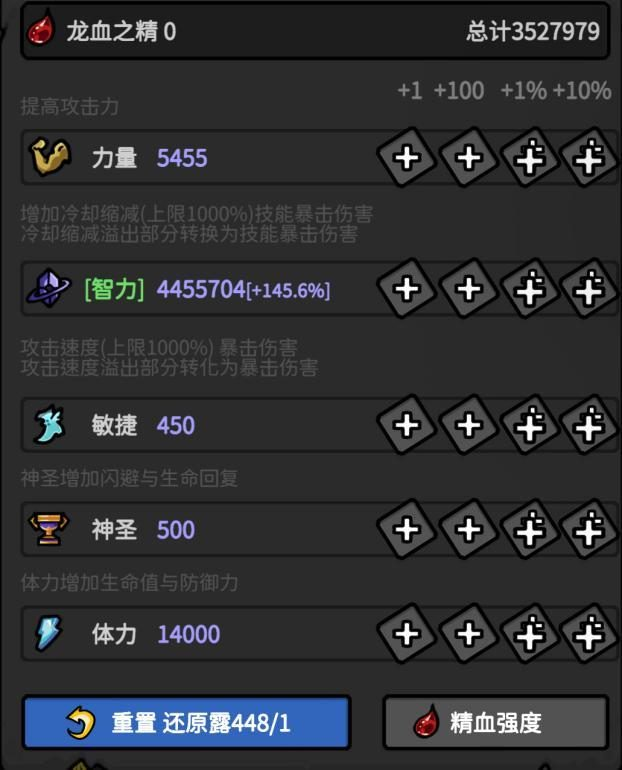

前期精血仅推荐加智力，当精血达到 5000 以上后，每次轮回可最多加 700 点神圣属性，使面板闪避达到 70%，具体加点数值可参照面板闪避情况调整。觉醒后智法神圣满闪避其他全智力，神法全神圣（冷却也变成神圣加了），力法神圣满闪避其他全力量，血法神圣满闪避其他全体力，注意血法体力不加血，改成神圣加血了。

### 职业专精

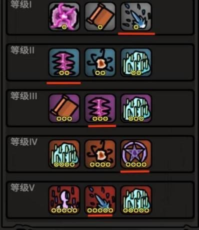

图中红线标识的是打塔加点推荐，挂机时点数充足的话优先点第四排第一个技能，其余技能可根据实际情况灵活选择。

解锁第五排技能后，若打龙时觉醒之力不足，可优先加点第五排第一个技能。

## 5. 广告

红框为必看，黄框为选看，装备改造箱前期缺少材料可选择观看。解锁天星、沙暴、异能、灵场、怒法等技能后，看御灵宝箱。若开出五星御灵，则再次看技能宝箱。等级升至 1000 级后，可以考虑购买恶灵附身皮肤。月卡玩家在解锁奥术能量瓶后建议购买，并保留至第五大阶段奥术之灵再行使用。要确保药水持续生效，该效果离线状态下也能触发，一旦药水不足请第一时间购买补充。碎片紧缺时，至少要保证经验获取不中断，不过灵魂资源也十分重要，具体取舍可自行判断。

## 6. 抽奖（异界碎片的使用）

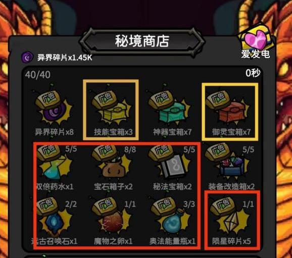

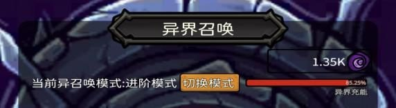

召唤模式直接切换为进阶，这样获得稀有材料可转换为神圣精华。每花费 800 异界碎片保底获得 100 神圣精华，神圣精华可用来兑换稀有材料，前期只建议兑换灵界精魄。抽奖是前期快速提升和获得资源的地方，未通关次元一 100 万关前，推关会获得异界碎片，在准备 1000 级时，需要留碎片购买 3888 碎片的恶灵附灵皮肤，购买完后继续抽奖。觉醒后预留 2000 异界碎片，方便锻造台转套装，购买双药这些的使用。

## 7. 兑换（神圣精华的使用）

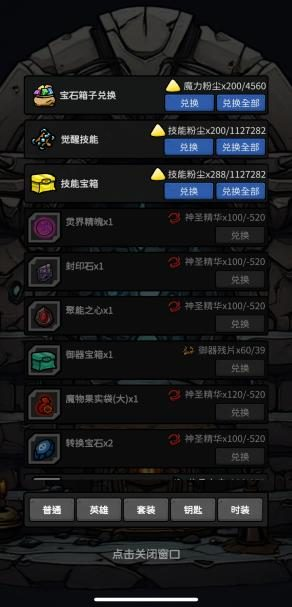

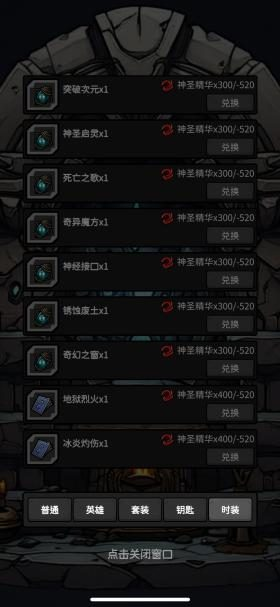

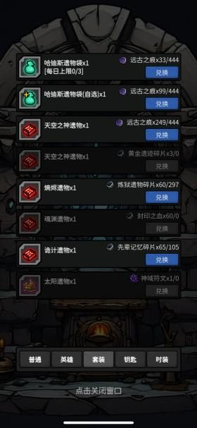

### 普通兑换

宝石箱子分解宝石给材料，有材料就直接兑换。觉醒技能（碎片）觉醒后直接兑换，觉醒技能升满再换技能宝箱。陨星碎片前期缺少材料不换。封印石消耗精魄兑换的直接排除。秘法宝箱（神圣）不建议兑换，原因看秘法内容。神作宝石纯浪费材料直接排除（重置匠魂等阶有用），装备直接通过铸造宝石供养来神作。神圣精华前期只建议兑换灵界精魄，使用神圣精华兑换封印石和聚能之心的自行选择兑换，聚灵很坑但有保底，非酋前期谨慎聚灵，另外聚能之心日常只能古神副本获取。御器宝箱 / 魔物宝箱 / 灵智晶体分解对应物品获得材料，有材料直接兑换，魔物果实袋（大）不建议，圣水自行选择，转换宝石价格昂贵不划算，学习药水 / 掠夺药水自行选择，前期不建议兑换。共鸣石只能通过精华兑换，魔物等阶高了再考虑换。神圣精华是稀缺材料请慎重考虑兑换。

### 时装兑换

推荐带着商店皮肤。兑换页只有突破次元里的天命在我皮肤，对未来次元四挂图有一点提升，追求完美可以抽，四随一看运气。

另外三个栏目，英雄都是一对一的材料，有就换。套装兑换规则直观易懂，新套装都有介绍与外观预览。钥匙就是各个英雄对应的门票，正常玩家不建议过多兑换钥匙，这是氪佬追赶老区玩家的重要渠道之一。

## 8. 成就

成就奖励领了就生效，不用在意之后如果变灰会扣除。成就里获得的皮肤全是无属性外观皮肤。成就在任务里的左上角打开，其中推关成就可获得力量，力量可提高攻击力。推塔成就可获得小怪增伤，小怪增伤是提高对推关里的小怪伤害。挑战副本成就可获得精英增伤效果，该效果在对抗龙塔等 BOSS 时有加成。广告成就可获得经验加成%，该经验加成为固定数值加成不吃转生加成。冷缩成就可解锁法术暴击、智力点数提升或投射物 +1 的奖励，这些奖励可通过转生加点来实现。

## 9. 御灵（6 星御灵需要打英雄副本，萌新别想，先培养好五星）

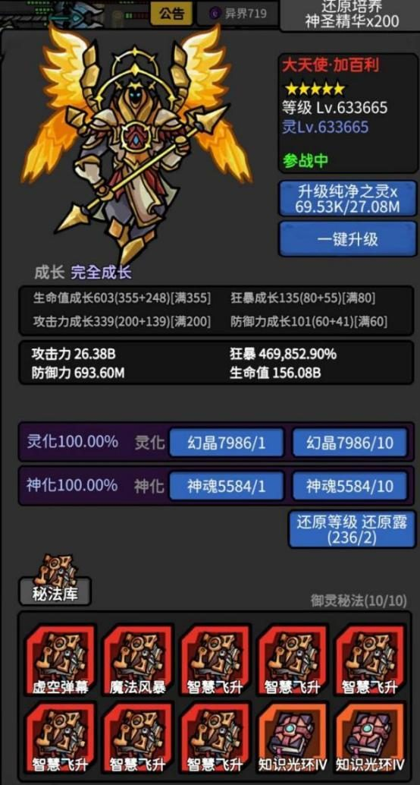

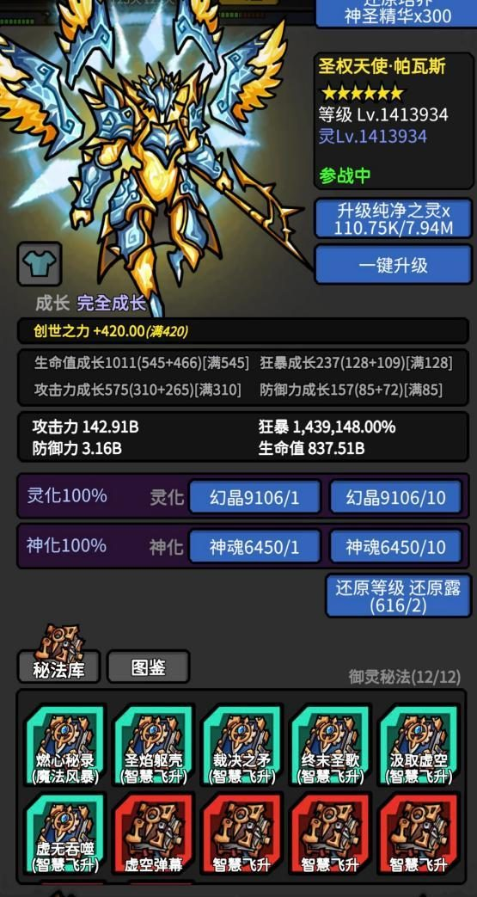

技能在解锁了地爆 / 风暴 / 灵场 / 异界后，广告里把限制的看完就看御灵宝箱，直到把五星御灵开出来，有两个五星御灵都行没差。没有五星御灵前不建议培养，非要培养也只点升级，不要灵化和神化，因为还原等级便宜且返还全部纯净之灵，还原幻晶和神魄贵。没五星御灵前不培养只上秘法。6 星创世御灵只有一个，英雄副本给的材料 180 个兑换后还需要花费 1200 个材料才能升满，慢慢来吧。

## 10. 秘法

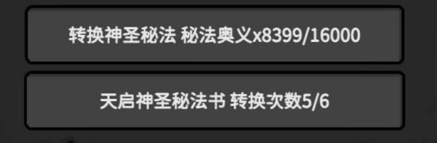

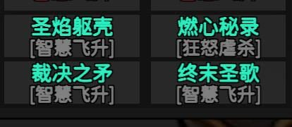

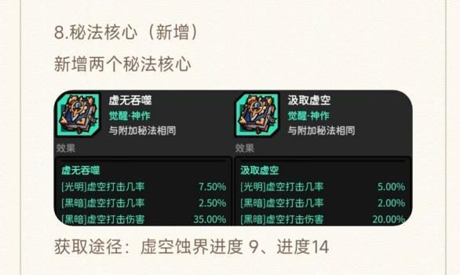

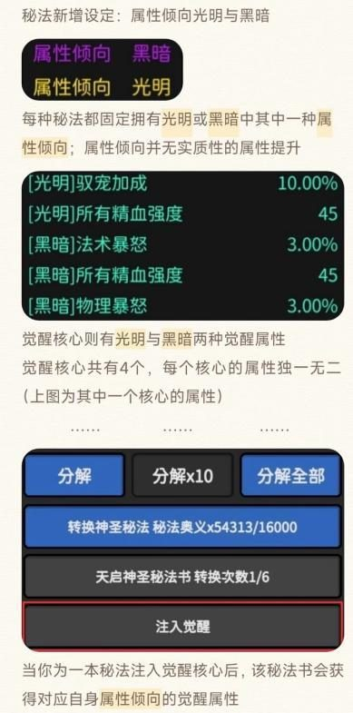

不要的秘法直接分解，会给材料：秘法奥义，但一定要留至少一本不要的红色秘法，进行秘法转换，转换是随机的，累计 6 次转换后，第 7 次可以无材料消耗点下面那个选项进行自选，注意会转换当前选择的红色秘法别点错了。自选选择智慧飞升 〉 凝血 〉 灵能生化，唯一秘法自行判断，等不及了也可以自选。

法师秘法选择橙秘（紫及以下同名，未提及的都是没用秘法）：知识光环、法力增强、凝血（日常挂图不戴，11w 龙塔后或恶魔塔或英雄时必要）、武器萃华Ⅳ（唯一）、生命手册Ⅳ（要留，开始使用橙色生命天赋书后秘法使用生命加成）、血脉觉醒（效果与灵能生化相近）。

红秘：虚空弹幕（唯一，常驻）、魔法风暴（唯一，常驻后期可考虑不带）、至高巫术（唯一）、异能法咒Ⅱ（唯一）、灵能生化、智慧飞升（要 11 本）、凝血（要 6 本）、武器萃华Ⅴ（唯一，最强输出秘法）。

秘法具备属性倾向，通常输出类秘法属性为黑暗，辅助类秘法属性为光明，觉醒核心需在御灵背包中使用。燃心秘录选择黑暗，圣焰躯壳 / 裁决之矛 / 终末圣歌选择光明，虚无吞噬和汲取虚空，个人建议选择光明挂图，可提升些许触发概率。

> （来源：山神宫-令北，版本更新指引）

## 11. 御器

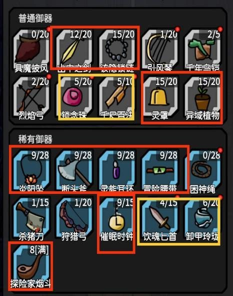

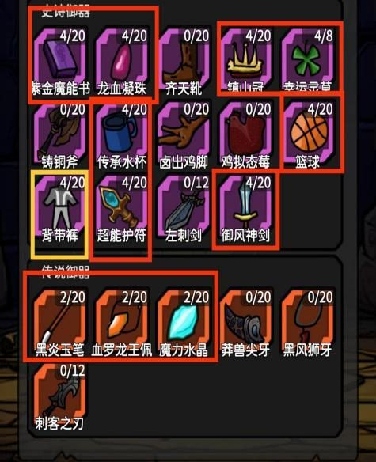

红框为必加，黄框为龙骨粉充足的情况下选加。

未框的请自行选择，可以在背包御器碎片处分解，兑换御器宝箱。

## 12. 魔物

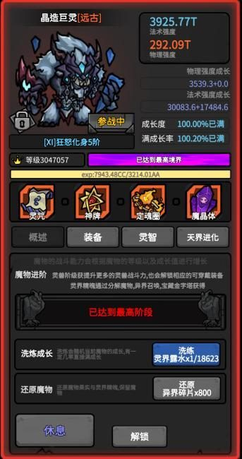

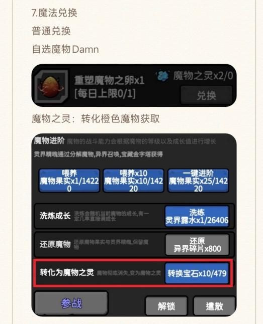

强度排序：红色远古只能由橙色魔物天界进化获得。晶魔（橙）= 幼龙（橙）〉 幼龙（紫）〉 其他紫色元素魔物 〉 其他。

遣散魔物前有培养的情况下，酌情考虑先还原魔物，并卸下魔物装备和灵智。前期有啥魔物带啥魔物，挑法术强度高的，没有紫魔物前不建议进阶和洗练。优先培养主魔物到 7 阶，在此之前不建议提升封印魔物等阶，升也最多到 2 阶。之后可以把封印魔物都升到 3 阶，再把主魔物升到 10 阶，不建议升 11 阶，不划算。

注：其他橙魔物可以用来封印。

### 魔物装备

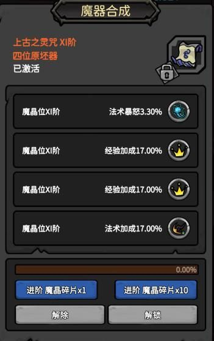

魔物装备也存在灵等级，不会超过当前魔物品阶。

前期有蓝色装备时，可选择装备双经验魔晶 / 法术加成魔晶。紫色装备必带双经验 + 法术加成（有多的暴怒可换），橙装备必带法术暴怒 + 法术加成（可考虑带释放）+ 双经验，橙装备属于稀缺资源，没有以上魔晶石不要合成！！

### 灵智（图为唯一毕业摆法）

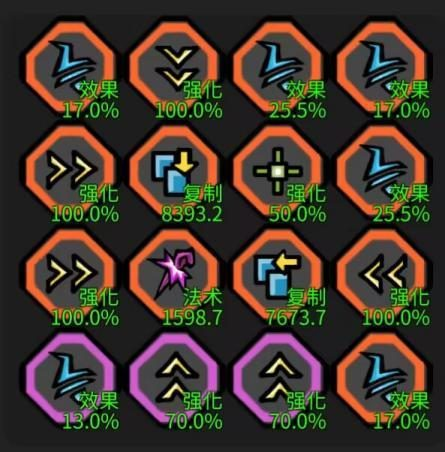

灵智融合度的判定仅看成长面板右侧的法术强度，可能出现融合度低但法术强度更高的情况。图为有双复制的摆放。前期有什么就上什么，只强化一个高品质的法术，强化优先强化法术其次复制。除去强化的法术，其他位置同品质下效果 〉 法术。灵智系统主要关注魔物面板中的法术强度，玩家需根据个人所拥有的碎片进行合理搭配。

### 天界进化

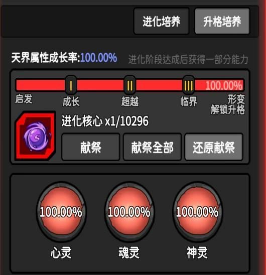

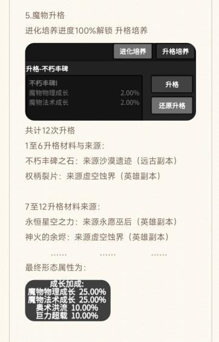

进化培养到形变后魔物会变成红色，之后还可以消耗进化核心将底下三个球依次点满，也是提升成长属性的。进化培养达到 100% 后即可进行升格培养，这是一个耗时固定的体系，大家循序渐进即可。当前版本魔物仅在前期提升幅度较大，因此驭宠加成属性的作用并不明显。

## 13. 魔物封印

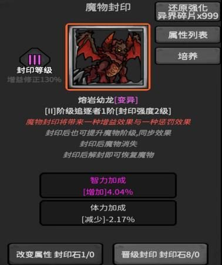

魔物只推荐封印橙魔物（锻造台可以花费一颗封印石转移封印，原装备不消失）。晋级封印和培养封印魔物等阶提升封印属性，其他培养都不需要。红魔物没有额外加成。

魔物被封印后，仍可继续提升自身等阶。需要注意的是，出战魔物在未达到 7 阶之前，不建议对其进行培养操作。

出战魔物达到 7 阶后，可将培养重心转向封印中的魔物，建议将其培养至封印等级 3、魔物阶级 3。

属性选择：7 个主属性加成（智法推荐智力加成，神法推荐神圣加成）加 1 个法术技能加成（不是法术加成）。缺材料的主属性加成可以换成冷缩之力过渡，但选择冷缩之力不能全选。冷缩之力顶多到 70，再高就不划算了，后期 40 左右就行。

## 14. 锻造台

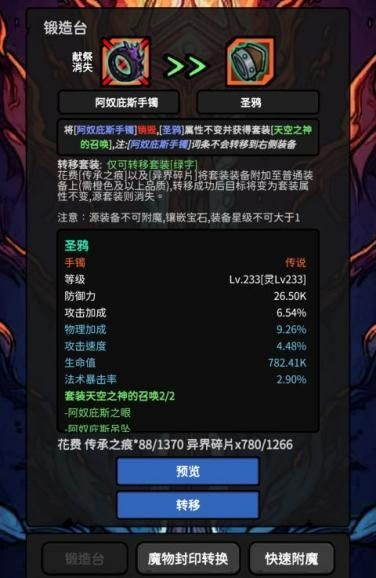

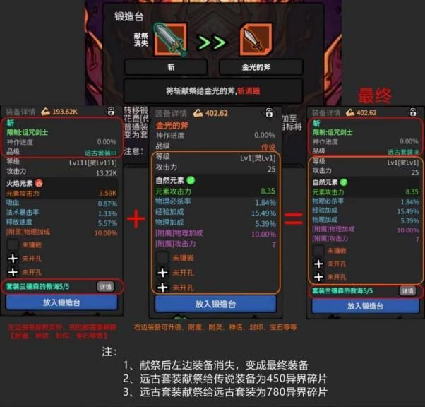

右边是普通装备消耗：450 异界碎片，38 传承之痕（分解套装一件一个）。

左侧放置目标套装（该套装需仅保留附灵与神作效果，不可带有封印、升星（还原后为 1 星 0%）、附魔、宝石等其他属性），右边放你的好装备（无论怎样都行），但其本身带套装（其他无用的），手续费贵 330 异界碎片和 50 传承之痕。套装锻造后依然可以继续锻造（反复套）。

## 15. 圣遗物及圣法点

仅供参考，自行选择。

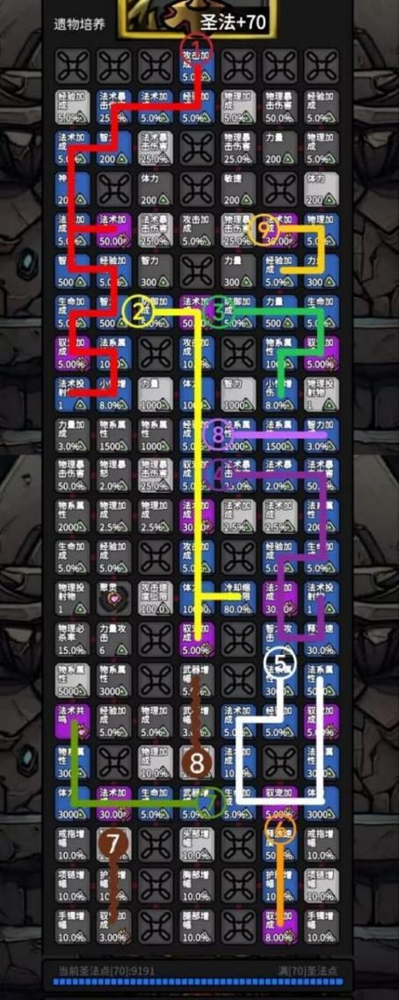

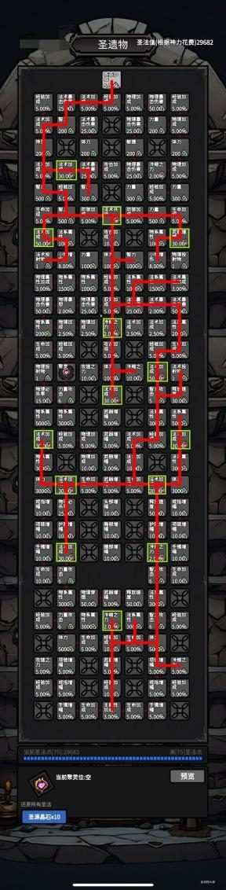

累计消耗转生神力可以获得圣法点，获取进度自行查看圣法面板下方进度条，Q 群文件里也有圣法点计算器。

聚灵：法术共鸣（限 1）= 法术增幅（限 3）〉 法术加成 50%（限 2）〉 灵能共鸣（限 3）〉 法术加成 30% 〉 驭宠加成 8% ≈ 冷缩之力 2%，武器增幅差点，除了这些就选下位替代，昂贵且难洗，凑合就好，不要上头。

下图为推荐圣法路线，其中 8 号路线智法选浅紫色，其他三个觉醒职业选咖啡色。

> （来源：星盟-爱你一生）

## 16. 奥术

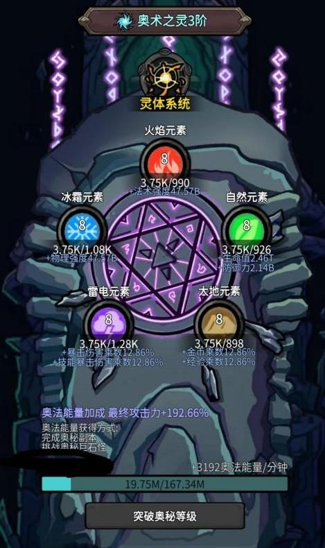

等级达到 5000 级后开启，开启需要 200 异界碎片。开启后装备会显示元素攻击力，该伤害提升等于 0，只是告诉你分解获得什么元素的材料。灵体仅提供法术加成，前期加成效果有限，可延后解锁，但需记得解锁。

奥秘中的元素能点就点，无需考虑物理强度之类的，相关材料仅能通过分解装备获取，且无其他用途。

挑战奥秘巨人请参考龙塔，一般龙塔有 2000 层的推进，巨人肯定能打高一层。

奥法能量瓶达到第五大阶段奥术之灵 1 阶后使用，实现收益最大化。

---

# 进阶内容

## 1. 觉醒（前面技能有提过）

次元二等级达到 2w 级后可在技能界面选择觉醒，四个觉醒职业综合强度差不多，当然挂图和打塔强度肯定是不同的，本身形象和技能效果也不同，群文件 10.0 中有各职业图片。

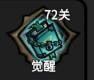

次元二后解锁觉醒塔，觉醒后可以消耗觉醒点跟点专精一样，觉醒点随便加就行，72 层很快就能打完，累计消耗觉醒点就会解锁两个觉醒技能和一个技能槽。技能栏利用觉醒技能碎片解锁并强化觉醒技能即可。

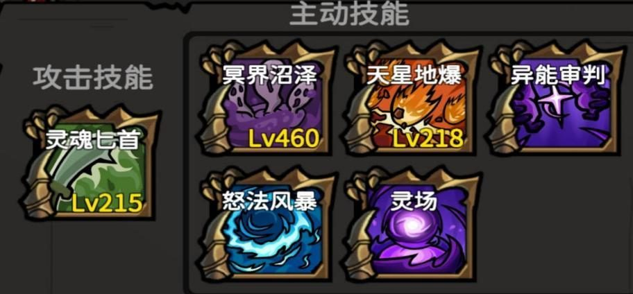

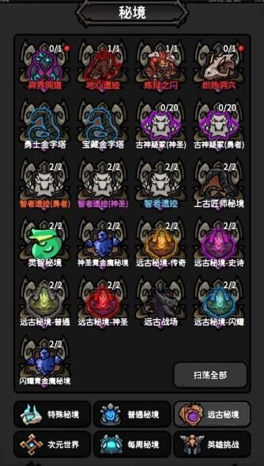

*图为智法觉醒后携带的攻击技能 / 主动技能*

前期升级比例为 2:1:1，可参考觉醒二技能 100 级、攻击技能 / 地爆 50 级，兑换觉醒技能碎片后觉醒 1 技能只强化 1 级解锁技能，觉醒 2 技能优先强化满级，再强化满觉醒 1 技能。觉醒技能满级后，加点变为觉醒 2 技能：觉醒 1 技能：地爆，3:2:1 或 5:4:2。

## 2. 远古秘境（更强套装兑换材料的获取渠道之一）

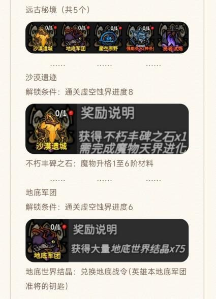

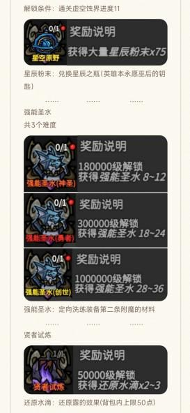

远古战场是装备（橙装和套装）及装备材料的主要获取渠道，觉醒后就可陆续挑战远古副本了。建议只挑战勇士金字塔，次元二难度过高，先提升实力再尝试，另外刚能打过时不代表之后一直都能打过，金字塔副本会随等级变强（有上限），存在同一次轮回期间，4w 级就能打过，升到 9w 级反而打不过的情况。对于古神疑冢，同样建议只挑战勇者难度，若无法通关，请保留材料以待日后实力提升后再挑战。副本挑战存在前置要求：4w 级解锁的炼狱之门，需集齐职业五件套后方可挑战。同为 4w 级解锁的炽热洞穴，需穿戴幽冥装备方可挑战。获取的材料可以在兑换套装栏里兑换进阶套装。熵烬余灰套装共有四件，穿戴两件即可完全激活套装属性，满足此条件后方可挑战地心遗迹，获取的材料在兑换套装栏兑换进阶职业套，三件套且只有三个部位，限制对应职业穿戴。15w 级解锁的异界网道可用于进阶职业套的升级，能带来大幅属性提升。

## 3. 英雄挑战（含材料用途介绍）

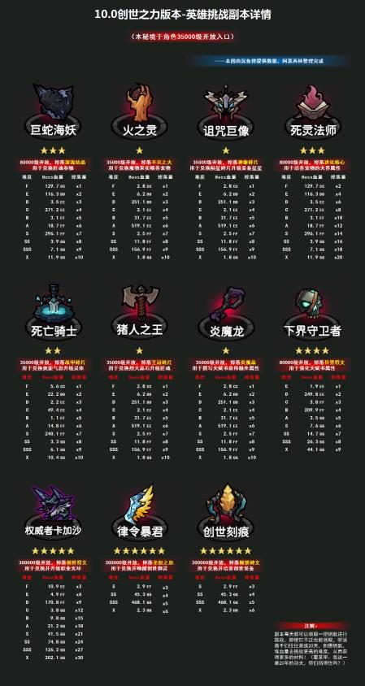

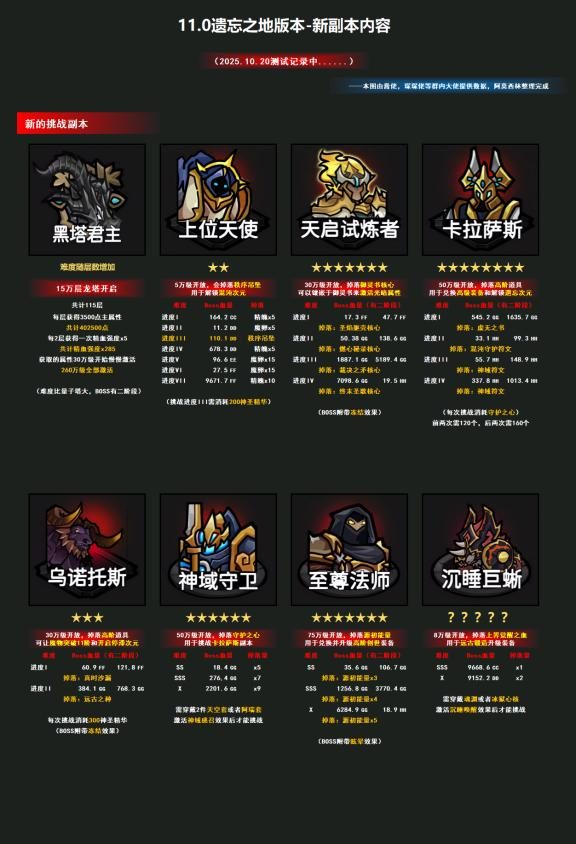

> （来源：山神宫-阿莫西林）

4w 级前会解锁火之灵 / 诅咒魔像 / 猪人之王 / 炎魔龙 / 死亡骑士，5w 解锁上位天使，8w 级解锁巨蛇海妖 / 死灵法师 / 下界守卫者 / 沉睡巨蜥，30w 级解锁权威者卡加沙 / 律令暴君 / 创世刻痕 / 天启试炼者 / 卡拉萨斯 / 乌诺托斯，50w 解锁神域守卫，75w 解锁至尊法师。

解锁后，每日领取一把钥匙，上限 20 把，超出无法领取。如果只能打 F 建议留 19 把钥匙，如果能破层打下一阶可考虑全部刷完，没破但感觉快了可以保持每天 19 把钥匙，钥匙请根据当前能挑战的难度自行选择留或刷，仅供参考。打完给的材料在兑换里都是一比一兑换的，除了光环只换自己职业的，其他直接换就行。

- **火之灵**：不灭之火，兑换魔物果实。
- **诅咒魔像**：神像碎片，兑换陨星碎片用于提升装备星级，增幅装备基础属性，优先升星武器。
- **猪人之王**：王冠碎片，兑换烈火晶石，用于培养镶嵌后的匠魂等阶。
- **炎魔龙**：炎魔晶，用于开启天赋书紫色橙色后的史诗撰写和传说撰写。
- **上位天使**：秩序吊坠用于解锁混沌次元。
- **乌诺托斯**：产出真时沙漏，用于解锁停滞次元；还产出远古之种，为魔物 10 阶升至 11 阶的升级材料。
- **死亡骑士**：战甲碎片，兑换奥能之息，用于提升奥秘中的灵体等级。
- **巨蛇海妖**：深海结晶，120 个兑换匠魂，匠魂可以镶嵌在任意神作装备上，可洗炼可拆卸。
- **死灵法师**：进化核心，橙色魔物三阶后开启天界进化，消耗本材料升红色魔物。
- **天启试炼者**：御灵书核心，在御灵秘法背包直接装到书上就行，20 遗忘水拆卸。
- **下界守卫者**：异界符文，用于强化天赋书属性。
- **权威者卡加沙**：创世符咒，兑换里换自己职业的光环。剩下的提升光环等阶。
- **律令暴君**：圣权之息，180 个材料兑换创世时空之镜（唯一 6 星御灵），1200 个材料用于洗练提升御灵。
- **创世刻痕**：解禁碑文，直接在创世晶核中使用，优先将四件（项链只需要一件自己职业的）装备解锁并镶嵌到装备上。解锁每件消耗 25 材料，共 100。之后每件每阶需消耗 100 材料，腕甲只有 2 阶，其他三件升满 3 阶，也就是 1100 材料。
- **神域守卫**：守护之心，用于挑战卡拉萨斯。
- **卡拉萨斯**：虚无之书，用于解锁遗忘次元，混沌守护符文，兑换创世新头盔。神域符文用来兑换毕业套装。
- **至尊法师**：源初能量，用于配合解禁碑文解锁新创世装备武器和头盔以及升级。
- **沉睡巨蜥**：掉落材料可用于进阶太阳或万军装备，装备其中一个套装方可挑战。
- **梦魇编织者**：二次进阶地心职业三级套的材料。
- **炼狱军团准将**：兑换深渊套的材料。
- **梦魇之主**：进阶深渊套的材料。
- **永愿巫后**：魔物升格 7 至 12 阶材料。

## 4. 虚空蚀界

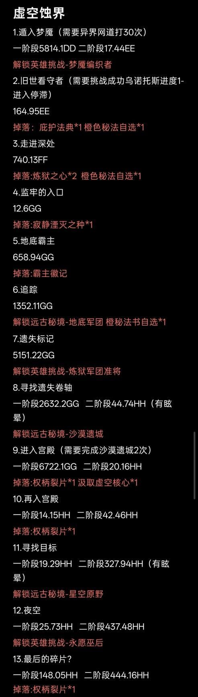

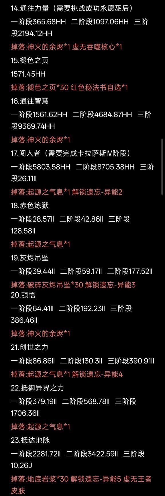

炼狱之心用于兑换创世手镯；寂静湮灭之种用于解锁灾厄次元；霸主徽记用于兑换创世鞋子；权柄裂片用于魔物升格；神火的余烬用于魔物升格；褪色之页用于解锁守护者等级上限 75 → 125；破碎灰烬吊坠 125 → 175；地底岩浆 175 → 225；起源之气息用于太阳套的进阶，需要四个才能完成进阶，之前不会有任何变化。

## 5. 守护者（虚空蚀界打过第二关获得庇护法典背包物品使用后解锁）

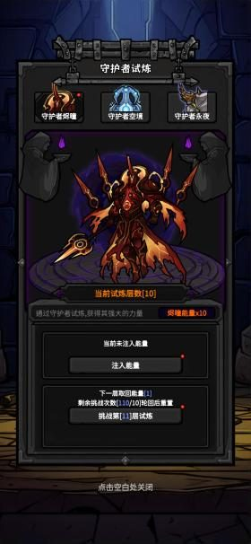

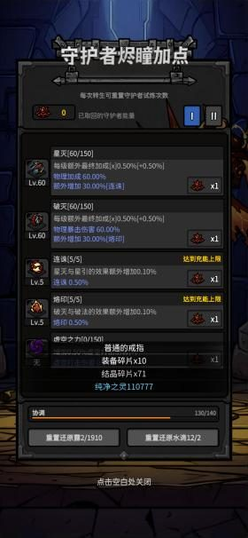

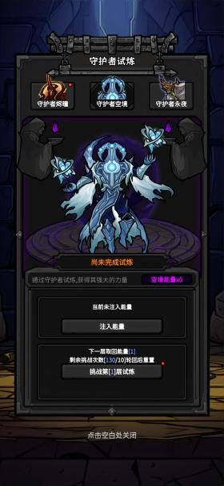

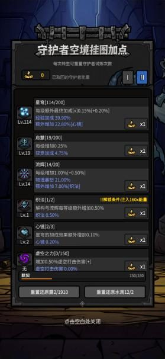

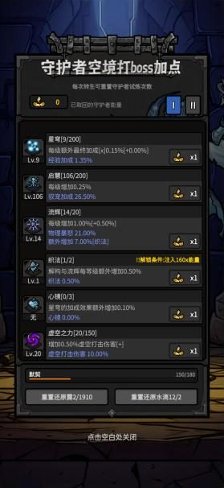

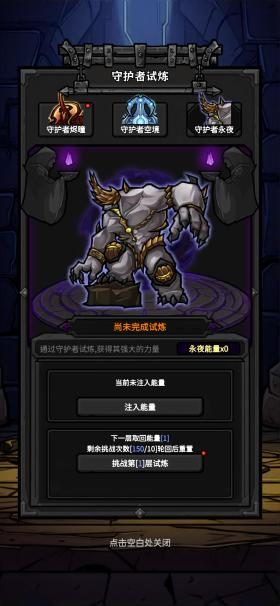

守护者共三个，初始次数为你当前轮回神力消耗按比例转换，往后每次转生挑战次数重置为 10 次（打不过不消耗），也就是说不管你次数是超过 10 次还是 6/7 次抑或是 0 次，转生后都只能打 10 次。所以每次转生前能打一定不要忘记了。另外三个塔初始次数不一样，难度越难次数越少，烬瞳（塔一）困难，空境（塔二）中等，永夜（塔三）简单，塔一 120 层难度相当于塔三 150 层。

三塔初始上限 75 层，打过虚空蚀界 15 层可解锁至 125 层，打过虚空蚀界 19 层可解锁至 175 层，打过虚空蚀界 23 层可解锁至 225 层（上限）。

塔一推荐星引与破法平均加点，连珠和烙印优先点满。

塔二分为挂机与 BOSS 战两种加点方案，可通过上图右上角按钮切换；挂机方案优先点满天穹，启慧仅作为前置加点满足其他技能解锁条件，解构、织法、心境能点就点满。打 boss 点满启慧，解构、织法、心境能点就点，想少点经验就只能用虚空之力凑数了。

塔三分为挂图和打 boss 两种加点方案：挂图时优先点满维度，裂隙、奇点、编织能点就点；打 boss 时锚点和维度按 1:2 比例加点，裂隙、奇点、编织能点就点。

虚空打击这个新玩意效果较差，能不点就不点，全渠道总触发概率才 23%，而这游戏暴击 99% 都能时不时看到不暴击的数值，懂的都懂。

## 6. 匠魂

英雄海妖 120 个材料兑换一个匠魂，背包使用后随机给一个属性，镶嵌后可以转换属性。新人 8 匠魂可以洗四个主属性加成 + 四个冷缩之力。让冷缩之力达到 40 以上，不用超过 70。进了遗忘次元就可以考虑六个主属性加成 + 二个冷缩之力。

## 7. （必看）次元 3 到混沌次元再到次元 4

解锁次元 3 需要 1T 神力，图为开始攒神力的转生加成。此时一般面板经验七八千。每个人的情况不一样，经验加成达到 320% 可选择攒神力进次 3。10w 级轮回后可获得 1T / 两次 8w 可获得 1T / 4 次 6.3w 可获得 1T，具体多少级轮回自行选择，可参考升级慢了就轮回。

进次元三后转生 1—2 次，达到 12w 级左右应该能打过上位天使获取秩序吊坠用于解锁混沌次元。

混沌次元是 11.0 对萌新最大的提升，在混沌次元经验是次元三的两倍，次元四的 75% 经验，但实测混沌 16w 层也就是同等难度次元四 4w 层之前，混沌经验是比次元四还高的，逐渐持平。所以次元四可以稍晚点再进，并不太急迫。

> 注意：混沌次元给的纯净之灵比次元三还要少，纯净之灵用于升级御灵等级，而御灵等级本身就难升级且很重要。所以在混沌次元和次元四经验相差不大的情况下建议去次元四挂图。

解锁次元四需要 85T 也就是 44w 级。因为混沌次元的存在，次元四可以晚点解锁，也就是 50w 级解锁完副本。

面板经验修正 2.5w 后可以考虑憋 44w 级，或者每日收益 8—10t 以上再考虑憋 44w 级。

## 8. 停滞次元、灾厄次元和遗忘次元

- **停滞次元**：乌诺托斯：真时沙漏，解锁停滞次元。难度相当权威者卡加沙 D 级（光环 boss），正常次元四挂图能到 7w 层，应该差不多可以打过。
- **灾厄次元**：经验是停滞次元的 1.3-2 倍，达到解锁所需的停滞次元 7.5w 层时，应该勉强能打过虚空蚀界第四层；如果打不过，等到停滞次元 8.2w 层时就一定能通关。
- **遗忘次元**：卡拉萨斯：虚无之书，用于解锁遗忘次元。难度比律令暴君 X 略难，停滞次元正常挂图到 15w 层左右就能打过。能进必进，经验比次元四起码高三四倍，实力越强经验越高。作者认为在停滞憋 30 天内能进遗忘，绝对不亏。也就是轮回三个输出达到 1900 左右。轮回三个输出 2300 挂机 12—15 天肯定能过。

遗忘次元异能 1 挂图 17w 层左右可以打过虚空蚀界 21 关解锁异能 4，异能 4 挂图到 22w-23w 层可以尝试虚空蚀界 23 关，要求轮回生命 3000 以上。

## 9. 恶魔塔、量子观测者、黑塔宫殿

恶魔塔和量子观测者的攻击均无法被闪避，但底层难度不高。通关量子观测者后，可获得创世之力（自动转化为最终伤害加成，更多里自行查看），只有量子观测者免疫创世之力加成的伤害。由于每位玩家的情况各不相同，建议大家最好在通关龙塔 10 万层后再尝试挑战恶魔塔，前期打恶魔塔可考虑加 1-2w 体力 / 2000-3000 神圣，装备上生命宝石 / 法术加成宝石 / 御灵里秘法上凝血 / 法力增强。量子观测者难度未知。

黑塔宫殿的黑塔君主在龙塔 15w 层后解锁，难度很高，加成在达到生效等级后直接生效，不需要直接加点。黑塔 50 层后匠魂如果还有冷缩之力，只留 3 个，其他换成主属性加成。

## 10. 天赋书

天赋书通过秘境远古智者遗迹和周副本图书馆获得。

前期选择五本职业强度 + 主属性数值，背包留好五本生命值 + 主属性数值（这个生命书中后期打 BOSS 至关重要），激活条件可以洗（条件一定要绿色再穿，不然词条和撰写不生效，只生效共鸣），激活材料可通过挑战副本或抽奖获取，获取难度较低。天赋书只能开出蓝白，紫橙需要分解天赋书的碎片升级获得。共鸣：材料只能通过精华兑换且难洗。最佳搭配 4（对应职业词条会给职业技能加成）+ 1（虚空污染单件），每本天赋书洗 18 次后可自选共鸣词条。生命天赋书先不要共鸣，后面有空余精华再说。符文强化：材料通过英雄副本下界守卫者获得，有就提升。装备撰写：天赋书紫色后开启，消耗 180 炎魔晶解锁史诗撰写词条，消耗 360 炎魔晶解锁传说撰写。紫色和橙色撰写都选择法术暴怒。撰写词条可通过转换宝石进行词条转换。炎魔晶通过英雄副本炎魔龙获得。

优先培养和共鸣强度天赋书，也可以先培养一本生命天赋书用于中期使用。中后期挑战 BOSS 时，建议携带两到三本生命天赋书，最好是橙色满阶的，是否进行共鸣可根据自身资源情况决定。

## 11. 光环（12.0 解锁上限至 21）

英雄副本权威者卡加沙（30w 级解锁）掉落材料创世符咒，可在英雄兑换处兑换法术光环（兑换光环具有唯一性，换了一次就不能再换了，只换自己要的就行）。兑换后的光环可在左侧背包的光环栏中穿戴以提升属性，所需的提升材料仍为创世符咒。光环 5 级前只有经验加成和法术加成两词条，之后新增主属性攻击词条。16 级后经验加成 115%，法术 275%，主属性攻击增加 18、法术投射 1。21 级后经验加成 165%，法术 400%，主属性攻击增加 20、精血强度 30、法术投射 2。光环副本难度跨度较大，前期不要着急换钥匙。光环升至满级需要 7548 个创世符咒。

## 12. 创世装备

创世装备优先集齐前四件，若有兑换武器的机会请优先兑换，无需担心资源浪费。创世装备需要在装备进阶里镶嵌后属性才能生效。注意项链和武器都有两件，其他职业的项链和武器对自身无作用，请注意不要兑换错误。新头盔材料获取副本难度较高，建议先在遗忘次元提升实力后再尝试挑战。

创世装备注入能量就能升级，武器加成最大优先升级，没有或者升满武器后再升级其他。

> （来源：山神宫-令北，版本更新指引）

## 13. 主要 boss 强度比对表（山神宫－沉鱼收集制作，12.0 待更新）

---

# 其他

## 1. 爱发电/免广

游戏时长达到一小时后，爱发点将在商店右上角开启，同时设置解锁兑换功能。

浏览器复制登录购买：`https://afdian.com/a/xingzuodao`（删除括号内容，防夹）。

在爱发电平台，可选择 52 元套餐免除广告。赞助后，网页将出现私信按钮，复制内容在游戏中兑换即可。

理性赞助，无免广一样玩。

## 2. 更换觉醒/职业

遗忘所有觉醒加点可以换觉醒职业，若需更换觉醒职业，请先考虑是否还原已强化的觉醒技能。更换后，原有觉醒技能虽保留但隐藏了，还需要返回去重置。

遗忘所有专精后可以遗忘职业，但不建议随便更换职业，除非魔物歪了。

更换职业成本很大，请慎重考虑。

## 3. 更换设备/丢档

在更换设备前，请在 q 群里私聊大学牲，避免出现丢档或炸档。未更换设备但存档异常，请勿删除游戏，需要通过大学牲解决。请勿删除游戏数据，避免存档丢失，但还是能通过大学牲解决。

## 4. 兑换码

兑换码在群公告跳转到频道帖子查看，会及时更新新兑换码，旧兑换码如有过期，请在评论指出，感谢反馈。

游戏时间 1 小时，设置出兑换码通道。

---

*本文档由原 PDF《12.0法师攻略初版（山神宫—狁辰）》整理而成，图片存于同目录 `assets/`。*
